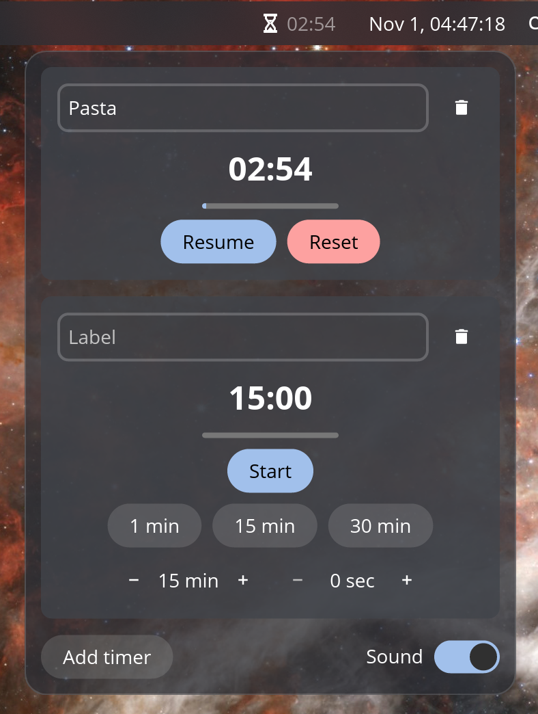

# Timer for COSMIC

A countdown timer applet for the [COSMIC](https://system76.com/cosmic) desktop
panel, written in Rust with [libcosmic](https://github.com/pop-os/libcosmic).



## Features

- Several labelled timers running in parallel; the panel shows the one that
  expires first, plus a counter of the others.
- Preset durations and custom minutes and seconds.
- Pause, resume and reset.
- Optional sound when a timer expires (toggle in the popup).
- Running timers survive a panel restart or a logout.
- Horizontal and vertical panels.
- English and Italian translations.

## Requirements

- COSMIC desktop with `cosmic-panel` / `cosmic-applets` 1.9 or later.
- `pw-play` (PipeWire) and the freedesktop sound theme for the expiry sound.
- To build: Rust (the version is pinned in `rust-toolchain.toml`, rustup
  picks it up automatically) and [`just`](https://github.com/casey/just).
- On Debian / Ubuntu / Pop!_OS, the build needs these packages:

  ```sh
  sudo apt install build-essential pkg-config libxkbcommon-dev
  ```

## Install

```sh
git clone https://github.com/angelinuxx/cosmic-ext-applet-timer.git
cd cosmic-ext-applet-timer
just install-user
```

This builds a release binary and copies it, together with the `.desktop`
file, the AppStream metadata and the icon, into `~/.local`. Make sure
`~/.local/bin` is in your `PATH`.

Then add the applet to the panel: **Settings → Desktop → Panel → Configure
applets → Add applet → Timer**.

To remove it: `just uninstall-user`.

## Configuration

Settings live under
`~/.config/cosmic/io.github.angelinuxx.CosmicExtAppletTimer/v1/`, one file per
key, and changes are picked up live:

| File            | Default       | Meaning                                  |
| --------------- | ------------- | ---------------------------------------- |
| `presets`       | `[5, 10, 15]` | Preset buttons in the popup, in minutes. |
| `sound_enabled` | `true`        | Play a sound when a timer expires.       |

## Development

```sh
just build-debug   # cargo build
just check         # clippy, pedantic
cargo test         # timer state machine tests
just dev-install   # symlink the release binary into ~/.local
just dev-reload    # rebuild and restart cosmic-panel
```

Logs: `journalctl --user -f`.

## Translations

Strings are Fluent files under `i18n/<lang>/cosmic_ext_applet_timer.ftl`.
To add a language, copy `i18n/en/` to the new language code and translate
the values.

## Licence

[MIT](LICENSE)
